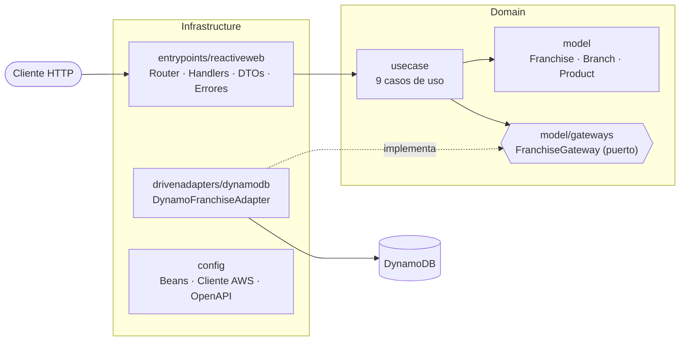
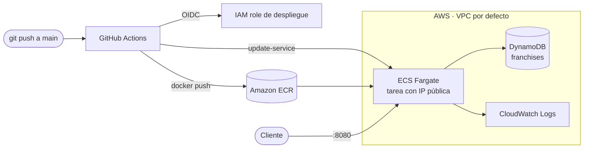

# Franchise API

API REST **reactiva** para gestionar franquicias, sus sucursales y los productos que ofrece cada sucursal.

Construida con **Spring Boot 4 + WebFlux** (Java 21), persistencia en **Amazon DynamoDB**, organizada con **Clean Architecture** (patrón Ports & Adapters), empaquetada con **Docker**, infraestructura como código con **Terraform** y despliegue continuo a **AWS ECS Fargate** con **GitHub Actions**.

---

## Tabla de contenido

- [Cumplimiento de la prueba](#cumplimiento-de-la-prueba)
- [Stack tecnológico](#stack-tecnológico)
- [Ejecución local (Docker)](#ejecución-local-docker)
- [Documentación de la API (Swagger)](#documentación-de-la-api-swagger)
- [Endpoints](#endpoints)
- [Pruebas](#pruebas)
- [Arquitectura](#arquitectura)
- [Modelo de datos en DynamoDB](#modelo-de-datos-en-dynamodb)
- [Despliegue en AWS](#despliegue-en-aws)
- [CI/CD](#cicd)
- [Decisiones de diseño](#decisiones-de-diseño)
- [Supuestos y limitaciones](#supuestos-y-limitaciones)
- [Estructura del proyecto](#estructura-del-proyecto)
- [Flujo de trabajo con Git](#flujo-de-trabajo-con-git)

---

## Cumplimiento de la prueba

### Criterios de aceptación

| # | Criterio | Implementación |
|---|----------|----------------|
| 1 | Proyecto en Spring Boot | Spring Boot 4.1 + WebFlux, Java 21 |
| 2 | Agregar una franquicia | `POST /api/v1/franchises` |
| 3 | Agregar una sucursal a una franquicia | `POST /api/v1/franchises/{franchiseId}/branches` |
| 4 | Agregar un producto a una sucursal | `POST /api/v1/franchises/{franchiseId}/branches/{branchId}/products` |
| 5 | Eliminar un producto de una sucursal | `DELETE /api/v1/franchises/{franchiseId}/branches/{branchId}/products/{productId}` |
| 6 | Modificar el stock de un producto | `PATCH /api/v1/franchises/{franchiseId}/branches/{branchId}/products/{productId}/stock` |
| 7 | Producto con más stock por sucursal de una franquicia | `GET /api/v1/franchises/{franchiseId}/products/top-stock` |
| 8 | Persistencia en la nube | Amazon DynamoDB (LocalStack en local) |

### Puntos extra

| Punto extra | Implementación |
|-------------|----------------|
| Empaquetado con Docker | `Dockerfile` multi-stage + `docker-compose.yml` |
| Programación reactiva / funcional | WebFlux, Reactor (`Mono`/`Flux`), endpoints funcionales, cliente async de DynamoDB |
| Actualizar nombre de la franquicia | `PATCH /api/v1/franchises/{franchiseId}` |
| Actualizar nombre de la sucursal | `PATCH /api/v1/franchises/{franchiseId}/branches/{branchId}` |
| Actualizar nombre del producto | `PATCH /api/v1/franchises/{franchiseId}/branches/{branchId}/products/{productId}` |
| Infraestructura como código | Terraform: DynamoDB, ECR, ECS Fargate, IAM, CloudWatch (`infra/terraform`) |
| Despliegue en la nube | AWS ECS Fargate mediante pipeline de GitHub Actions |

---

## Stack tecnológico

| Área | Tecnología |
|------|------------|
| Lenguaje / framework | Java 21, Spring Boot 4.1, Spring WebFlux, Project Reactor |
| Persistencia | Amazon DynamoDB (AWS SDK v2, Enhanced **Async** Client) |
| Validación | Jakarta Bean Validation |
| Documentación | springdoc-openapi (OpenAPI 3 + Swagger UI) |
| Pruebas | JUnit 5, AssertJ, Mockito, Reactor Test (`StepVerifier`), `WebTestClient`, Testcontainers + LocalStack, ArchUnit |
| Contenedores | Docker / Podman, Docker Compose, LocalStack |
| Infraestructura | Terraform, AWS (DynamoDB, ECR, ECS Fargate, IAM, CloudWatch) |
| CI/CD | GitHub Actions con autenticación OIDC hacia AWS |

---

## Ejecución local (Docker)

### Requisitos

- Docker con Docker Compose, **o** Podman con `podman compose`.
- Nada más: no se necesita Java, Gradle ni una cuenta de AWS para ejecutar la aplicación.

### Levantar todo con un comando

```bash
git clone https://github.com/EduardoZabala/franchise-api.git
cd franchise-api
docker compose up --build -d
```

Esto levanta dos contenedores:

| Servicio | Descripción | Puerto |
|----------|-------------|--------|
| `localstack` | Emula DynamoDB. Un script de inicio crea la tabla `franchises` automáticamente | `4566` |
| `franchise-api` | La API. Espera a que la tabla exista antes de arrancar | `8080` |

Verificar que ambos estén `healthy`:

```bash
docker compose ps
curl http://127.0.0.1:8080/actuator/health
```

Detener:

```bash
docker compose down
```

> **Usuarios de Podman:** `podman compose` no recrea los contenedores cuando cambia la imagen.
> Después de modificar el código ejecuta `podman compose down && podman compose up --build -d`.

### Configuración (opcional)

Funciona sin configurar nada. Para cambiar puertos, región o el nombre de la tabla:

```bash
cp .env.example .env   # editar los valores
docker compose up --build -d
```

| Variable | Por defecto | Descripción |
|----------|-------------|-------------|
| `API_PORT` | `8080` | Puerto de la API en el host |
| `LOCALSTACK_PORT` | `4566` | Puerto de LocalStack en el host |
| `AWS_REGION` | `us-east-1` | Región de AWS |
| `AWS_ACCESS_KEY_ID` / `AWS_SECRET_ACCESS_KEY` | `test` | Credenciales (LocalStack acepta cualquier valor; no son secretos) |
| `DYNAMODB_TABLE_NAME` | `franchises` | Nombre de la tabla |

### Ejecutar sin Docker (opcional)

Requiere Java 21 y un DynamoDB accesible (por ejemplo, el LocalStack del compose):

```bash
docker compose up -d localstack
DYNAMODB_ENDPOINT=http://127.0.0.1:4566 AWS_ACCESS_KEY_ID=test AWS_SECRET_ACCESS_KEY=test ./gradlew bootRun
```

La aplicación lee su configuración de variables de entorno (`application.properties`):
si `DYNAMODB_ENDPOINT` está vacío se conecta al DynamoDB real de AWS.

---

## Documentación de la API (Swagger)

Con la aplicación en ejecución:

| Recurso | URL |
|---------|-----|
| Swagger UI | http://127.0.0.1:8080/swagger-ui.html |
| Especificación OpenAPI (JSON, importable en Postman) | http://127.0.0.1:8080/v3/api-docs |

---

## Endpoints

Base: `/api/v1/franchises`

| Método | Ruta | Descripción | Éxito |
|--------|------|-------------|-------|
| `POST` | `/` | Crear franquicia | `201` |
| `PATCH` | `/{franchiseId}` | Renombrar franquicia | `200` |
| `POST` | `/{franchiseId}/branches` | Agregar sucursal | `201` |
| `PATCH` | `/{franchiseId}/branches/{branchId}` | Renombrar sucursal | `200` |
| `POST` | `/{franchiseId}/branches/{branchId}/products` | Agregar producto | `201` |
| `DELETE` | `/{franchiseId}/branches/{branchId}/products/{productId}` | Eliminar producto | `204` |
| `PATCH` | `/{franchiseId}/branches/{branchId}/products/{productId}/stock` | Modificar stock | `200` |
| `PATCH` | `/{franchiseId}/branches/{branchId}/products/{productId}` | Renombrar producto | `200` |
| `GET` | `/{franchiseId}/products/top-stock` | Producto con más stock de cada sucursal | `200` |

### Ejemplo de uso completo

```bash
API=http://127.0.0.1:8080/api/v1/franchises

# 1. Crear franquicia
curl -s -X POST $API -H 'Content-Type: application/json' -d '{"name":"Burger House"}'
# {"id":"<franchiseId>","name":"Burger House"}

# 2. Agregar sucursales
curl -s -X POST $API/<franchiseId>/branches -H 'Content-Type: application/json' -d '{"name":"Centro"}'
curl -s -X POST $API/<franchiseId>/branches -H 'Content-Type: application/json' -d '{"name":"Norte"}'

# 3. Agregar productos
curl -s -X POST $API/<franchiseId>/branches/<branchId>/products \
  -H 'Content-Type: application/json' -d '{"name":"Papas","stock":10}'

# 4. Modificar stock
curl -s -X PATCH $API/<franchiseId>/branches/<branchId>/products/<productId>/stock \
  -H 'Content-Type: application/json' -d '{"stock":80}'

# 5. Producto con más stock por sucursal
curl -s $API/<franchiseId>/products/top-stock
```

Respuesta del criterio 7 (cada elemento indica la sucursal a la que pertenece):

```json
[
  { "branchId": "b1…", "branchName": "Centro", "productId": "p1…", "productName": "Papas", "stock": 80 },
  { "branchId": "b2…", "branchName": "Norte",  "productId": "p3…", "productName": "Helado", "stock": 30 }
]
```

### Formato de errores

Todos los errores devuelven la misma estructura:

```json
{
  "code": "REQ-001",
  "message": "Invalid request",
  "details": ["name: must not be blank", "stock: must be greater than or equal to 0"]
}
```

| HTTP | Cuándo | Códigos |
|------|--------|---------|
| `400` | Petición inválida o regla de negocio violada | `REQ-001` (validación), `REQ-002` (JSON mal formado), `PRD-003`… |
| `404` | Franquicia, sucursal o producto inexistente | `FRN-005`, `BRN-005`, `PRD-004` |
| `409` | Nombre duplicado dentro de la franquicia o sucursal | `FRN-004`, `BRN-004` |
| `500` | Error inesperado (sin exponer detalles internos) | `ERR-500` |

El catálogo completo de errores de negocio está en
[`BusinessMessage`](src/main/java/com/franchise/domain/model/exception/BusinessMessage.java).

---

## Pruebas

**128 pruebas** organizadas por capa:

| Capa | Pruebas | Herramientas | Qué verifican |
|------|---------|--------------|---------------|
| Dominio (entidades) | 60 | JUnit 5, AssertJ | Invariantes, inmutabilidad, unicidad de nombres, producto con más stock |
| Casos de uso | 32 | Mockito, `StepVerifier` | Flujos reactivos, errores de negocio, que no se persista ante un error |
| API web | 20 | `WebTestClient` | Rutas, códigos HTTP, contrato JSON, validación, mapeo de errores |
| Adaptador DynamoDB | 7 | Testcontainers + LocalStack | Integración real contra la API de DynamoDB |
| Arquitectura | 8 | ArchUnit | Regla de dependencia de Clean Architecture |
| Contexto Spring | 1 | Spring Boot Test | Que la aplicación arranca |

```bash
# Todas las pruebas (requiere Docker o Podman en ejecución para Testcontainers)
./gradlew test

# Solo dominio y casos de uso (no requieren Docker)
./gradlew test --tests 'com.franchise.domain.*'

# Por capa
./gradlew test --tests 'com.franchise.infrastructure.entrypoints.*'
./gradlew test --tests 'com.franchise.infrastructure.drivenadapters.*'
./gradlew test --tests 'com.franchise.architecture.*'
```

Reporte HTML: `build/reports/tests/test/index.html`.

> Con Podman, Testcontainers necesita la variable `DOCKER_HOST` apuntando al socket de Podman
> (por ejemplo `unix:///run/user/1000/podman/podman.sock`).

---

## Arquitectura

**Clean Architecture** implementada con el patrón **Ports & Adapters**. Las dependencias de código apuntan siempre
hacia el dominio; el dominio no conoce Spring, AWS ni HTTP.



| Capa | Paquete | Responsabilidad | Depende de |
|------|---------|-----------------|------------|
| Entities | `domain.model` | Reglas de negocio de la empresa: entidades inmutables que protegen sus invariantes | Nada (Java puro) |
| Gateways | `domain.model.gateways` | Puertos de salida: lo que el dominio necesita del exterior | Entidades, Reactor |
| Use cases | `domain.usecase` | Reglas de la aplicación: orquestan entidades y gateways. Una clase por caso de uso | Entidades, gateways |
| Entry points | `infrastructure.entrypoints` | Adaptador de entrada: HTTP → caso de uso → respuesta | Dominio |
| Driven adapters | `infrastructure.drivenadapters` | Adaptador de salida: implementa los gateways con DynamoDB | Dominio, AWS SDK |
| Config | `infrastructure.config` | Ensambla todo: registra los casos de uso como beans | Todas |

Los casos de uso **no tienen anotaciones de Spring**: se registran en
[`UseCaseConfig`](src/main/java/com/franchise/infrastructure/config/UseCaseConfig.java).

La regla de dependencia no es solo una convención: está verificada por
[`CleanArchitectureTest`](src/test/java/com/franchise/architecture/CleanArchitectureTest.java) (ArchUnit),
que hace fallar el build si, por ejemplo, el dominio importa Spring o AWS.

---

## Modelo de datos en DynamoDB

**Single-table design**: cada franquicia ocupa una partición con todos sus elementos.

| `pk` | `sk` | `type` | Atributos |
|------|------|--------|-----------|
| `FRANCHISE#{franchiseId}` | `METADATA` | `FRANCHISE` | `id`, `name` |
| `FRANCHISE#{franchiseId}` | `BRANCH#{branchId}` | `BRANCH` | `id`, `name` |
| `FRANCHISE#{franchiseId}` | `BRANCH#{branchId}#PRODUCT#{productId}` | `PRODUCT` | `id`, `branchId`, `name`, `stock` |

| Operación | Acceso a DynamoDB |
|-----------|-------------------|
| Obtener una franquicia completa (criterio 7) | **1 query** por `pk` |
| Obtener una sucursal con sus productos | **1 query** por `pk` + `begins_with(sk, "BRANCH#{branchId}")` |
| Crear / actualizar un elemento | 1 `PutItem` |
| Eliminar un producto | 1 `DeleteItem` |

Las escrituras son **granulares**: cada operación modifica un único ítem en lugar de reescribir la franquicia completa.

---

## Despliegue en AWS

### Arquitectura en la nube



Recursos creados por Terraform (`infra/terraform`):

| Archivo | Recursos |
|---------|----------|
| `dynamodb.tf` | Tabla `franchises` (on-demand, cifrada, point-in-time recovery) |
| `ecr.tf` | Repositorio de imágenes con política de retención (últimas 10) |
| `ecs.tf` | Cluster, task definition, service Fargate, security group, log group |
| `iam.tf` | Rol de ejecución de ECS y rol de la aplicación con permisos mínimos sobre su tabla |
| `github-oidc.tf` | Proveedor OIDC de GitHub y rol de despliegue (solo la rama `main` puede desplegar) |

La aplicación obtiene credenciales del **rol IAM de la tarea**: no hay access keys en el código, la imagen ni GitHub.

### Pasos

Requisitos: Terraform ≥ 1.6, AWS CLI con credenciales válidas (`aws sts get-caller-identity`).

```bash
cd infra/terraform
cp terraform.tfvars.example terraform.tfvars   # opcional: ajustar región, repositorio, CIDR permitido
terraform init

# 1. Crear la infraestructura sin tareas (todavía no hay imagen en ECR)
terraform apply -var desired_count=0

# 2. Ver las variables que necesita GitHub Actions
terraform output github_actions_variables
```

3. En GitHub, en *Settings → Secrets and variables → Actions → Variables*, crear `AWS_REGION`, `AWS_ROLE_ARN`,
   `ECR_REPOSITORY`, `ECS_CLUSTER` y `ECS_SERVICE` con los valores del paso anterior.
4. Hacer merge a `main`: el pipeline construye la imagen y la publica en ECR.
5. Encender el servicio y obtener la URL:

```bash
terraform apply                       # desired_count vuelve a 1
../scripts/get-api-url.sh             # http://<ip-publica>:8080
```

Desde ese momento, cada merge a `main` despliega automáticamente.

### Costos y limpieza

- Una tarea Fargate de 0.25 vCPU / 0.5 GB cuesta aproximadamente **USD 9/mes**; DynamoDB on-demand cuesta céntimos con este volumen.
- Pausar sin destruir: `terraform apply -var desired_count=0`.
- Eliminar todo: `terraform destroy`.

---

## CI/CD

Pipeline en [`.github/workflows/ci-cd.yml`](.github/workflows/ci-cd.yml):

```
Pull request a main ─▶ [Build & test]  [Terraform validate]
Push a main         ─▶ [Build & test]  [Terraform validate] ─▶ [Deploy a ECS]
```

| Job | Qué hace |
|-----|----------|
| **Build & test** | Ejecuta las 128 pruebas (incluida la integración con LocalStack) y publica el reporte |
| **Terraform validate** | `fmt -check`, `init` y `validate` de la infraestructura |
| **Deploy** | Autenticación OIDC (sin secretos guardados) → build y push de la imagen a ECR (tag del commit + `latest`) → despliegue progresivo en ECS → espera a que el servicio esté estable |

El job de despliegue se omite automáticamente mientras las variables de AWS no estén configuradas,
y ECS revierte solo a la versión anterior si la nueva no llega a estar saludable (*deployment circuit breaker*).

---

## Decisiones de diseño

| Decisión | Motivo |
|----------|--------|
| Entidades como `record` inmutables | Cada cambio devuelve una instancia nueva con el mismo `id` (misma identidad, nuevo estado). Sin estado compartido, encaja con el modelo reactivo |
| Validación en el constructor de las entidades | Es imposible crear una entidad inválida, sin importar desde dónde se construya |
| Catálogo de errores `BusinessMessage` | Códigos estables para los clientes y un único lugar con todos los mensajes |
| Validación en dos niveles | Los DTO validan la *forma* de la petición; el dominio valida las *reglas de negocio* |
| Gateway con operaciones granulares | Cada escritura toca un único ítem de DynamoDB |
| `Mono.fromCallable` / `Mono.fromFuture(() -> …)` | Las excepciones del dominio se convierten en señales de error y las llamadas a AWS ocurren al suscribirse, sin bloquear hilos |
| "No encontrado" como `Mono` vacío en el gateway | El caso de uso decide cuándo eso es un error de negocio (`switchIfEmpty`) |
| Endpoints funcionales (`RouterFunction`) | Estilo funcional de WebFlux, con todas las rutas en un solo lugar |
| `ApiErrorHandler` como único traductor a HTTP | El dominio no conoce códigos HTTP |
| Mensajes de validación explícitos | Las respuestas no dependen del idioma configurado en el servidor |
| LocalStack en local y en las pruebas | El mismo código funciona contra LocalStack y contra AWS; solo cambia `DYNAMODB_ENDPOINT` |
| ECS Fargate en lugar de EC2 | Se despliega la misma imagen Docker sin administrar servidores, con rol IAM por tarea y despliegues progresivos |
| OIDC entre GitHub y AWS | El pipeline obtiene credenciales temporales; no existen access keys de larga duración |

---

## Supuestos y limitaciones

- **Unicidad de nombres:** dentro de una franquicia no puede haber dos sucursales con el mismo nombre, ni dos productos con el mismo nombre dentro de una sucursal (sin distinguir mayúsculas). Los nombres de franquicia no son únicos a nivel global.
- **Criterio 7:** las sucursales sin productos no aparecen en el resultado. Si dos productos empatan en stock, se devuelve uno de ellos.
- **Concurrencia:** la unicidad de nombres se valida en memoria; dos peticiones simultáneas con el mismo nombre podrían pasar ambas. Mejora futura: escrituras condicionales o transacciones de DynamoDB.
- **Exposición en AWS:** sin balanceador de carga, la tarea se publica con su IP pública, que cambia en cada despliegue. Mejora futura: Application Load Balancer con dominio y HTTPS.
- **Estado de Terraform:** se guarda localmente. Para trabajo en equipo debería usarse un backend remoto (S3 + bloqueo).

---

## Estructura del proyecto

```
franchise-api
├── src/main/java/com/franchise
│   ├── domain
│   │   ├── model                    Franchise, Branch, Product, BranchTopProduct
│   │   │   ├── gateways             FranchiseGateway
│   │   │   └── exception            BusinessException, BusinessMessage
│   │   └── usecase                  franchise/, branch/, product/
│   └── infrastructure
│       ├── entrypoints/reactiveweb  router/, handler/, dto/, error/
│       ├── drivenadapters/dynamodb  adaptador, ítem de tabla, mapper
│       └── config                   casos de uso, DynamoDB, OpenAPI
├── src/test/java/com/franchise      pruebas espejo por capa + architecture/
├── docker/localstack                script de creación de la tabla
├── infra
│   ├── terraform                    infraestructura en AWS
│   └── scripts                      utilidades (URL pública de la tarea)
├── .github/workflows                pipeline CI/CD
├── Dockerfile
├── docker-compose.yml
└── .env.example
```

---

## Flujo de trabajo con Git

- Una rama por funcionalidad (`feat/…`, `build/…`, `docs/…`) integrada a `main` mediante pull request.
- Mensajes de commit siguiendo [Conventional Commits](https://www.conventionalcommits.org/)
  (`feat:`, `test:`, `build:`, `ci:`, `docs:`).
- Cada commit incluye el código junto con sus pruebas.
- El pipeline ejecuta las pruebas y la validación de Terraform en cada pull request hacia `main`.
